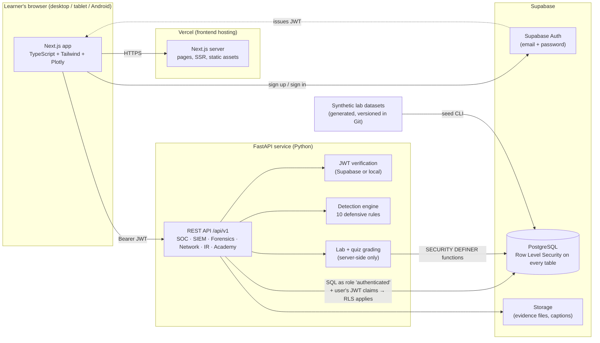

# Cybersec Academy — Architecture

> Phase 01 deliverable. Living document: update it whenever a decision changes.

## 1. What we are building

Cybersec Academy is a **defensive** cybersecurity learning platform. It combines a
learning management system (the Academy) with five simulated lab departments
(SOC, SIEM, Forensics, Network, Incident Response). Every lab runs on
**synthetic, pre-generated data**. Nothing in the platform touches real
third-party systems.

## 2. System diagram



## 3. Key decisions (and why)

| # | Decision | Why |
|---|----------|-----|
| D1 | **Schema lives in plain SQL migrations** (`database/migrations`) | Supabase is Postgres. Plain SQL runs unchanged in the Supabase SQL editor, Supabase CLI, and local Postgres. It also lets us express RLS policies, which ORMs cannot. |
| D2 | **Backend queries run as the `authenticated` role with the user's JWT claims set** | This is how Supabase's own API works. It means Row Level Security protects data even if a backend endpoint has a bug (defence in depth). |
| D3 | **Answer keys live in tables no learner can read** (`question_answer_keys`, `lab_exercise_answer_keys`); grading is done by `SECURITY DEFINER` SQL functions | A learner with the public anon key could otherwise read answers straight from the database, or write their own score. |
| D4 | **Two auth modes: `local` and `supabase`** | Supabase is not reachable from the current build environment. `local` mode lets us build and test everything now, using the exact same JWT claim shape (`sub`, `role`, `email`) that Supabase issues. Switching to Supabase is a config change, not a rewrite. |
| D5 | **Detection rules are pure Python functions over event lists** | Easy to read, easy to unit-test, and the same code runs in the SIEM lab ("run this rule") and when generating SOC alerts. |
| D6 | **Synthetic data is generated by deterministic code (fixed random seed)** | Every environment gets identical data, so tests can assert exact counts ("rule 1 fires exactly twice"). IP addresses come only from RFC 5737 documentation ranges and RFC 1918 private ranges, so no real host is ever referenced. |
| D7 | **Per-learner lab workspaces** | Alerts and event logs are shared, read-only training data. Each learner's triage decisions, investigations, notes and incidents are private rows protected by RLS. Learners cannot see or change each other's work. |
| D8 | **Monorepo** | One place for frontend, backend, database, datasets and docs. Easier for a single developer and for portfolio review. |

## 4. Hosting plan (to be re-verified against current provider docs in Phase 15)

| Part | Host | Notes / limitations to verify |
|------|------|-------------------------------|
| Next.js frontend | **Vercel** (Hobby, free) | Native Next.js support; preview deployment per branch → our staging. |
| FastAPI backend | **Option A: Vercel Python Functions** (free) — **Option B: Google Cloud Run or Render** using `docker/backend.Dockerfile` | Serverless functions are stateless with execution time limits and cold starts. Our API is short request/response work (the detection engine processes ~400 events in milliseconds), so it fits. Serverless must use Supabase's **pooled** connection string (port 6543). If we later need long-running jobs, move to Option B; the Dockerfile keeps that a config change. |
| Database, Auth, Storage | **Supabase** (free tier) | Free projects pause after a period of inactivity; fine for a portfolio project. |

## 5. Repository layout

```
.
├── backend/               FastAPI app (app/) and its tests (tests/)
├── database/
│   ├── migrations/        Ordered SQL: schema, RLS, functions. Runs on Supabase as-is.
│   ├── local/             LOCAL-ONLY shim that imitates Supabase's auth schema. Never run on Supabase.
│   ├── seed/              Generated seed SQL (synthetic data) for the Supabase SQL editor
│   └── tests/             SQL-level security tests (RLS, grading, workflow triggers)
├── labs/                  Lab datasets and scenario documentation, one folder per department
├── educational-content/   Courses, lessons, video storyboards, caption files
├── design/                Design tokens and reviewable screen mockups
├── docs/                  Architecture, tracker, integrations, learning journal
├── docker/                Dockerfiles / compose for isolated development
└── tests/e2e/             End-to-end browser tests (added with the frontend)
```

Change from the suggested structure: tests live **next to the code they test**
(`backend/tests`, `database/tests`) because each part has its own test runner.
The top-level `tests/` folder is kept for cross-cutting end-to-end tests.
`design/` was added because the Figma file is blocked by plan limits (see
`docs/INTEGRATIONS.md`), so design tokens and mockups are versioned in Git.

## 6. Security model (summary)

* Every table has RLS **enabled**. Default is deny; each policy is a deliberate allow.
* Roles: `student` (default), `instructor`, `admin`. Role changes only by an admin.
* Learners cannot update their own `role_id` (column-level privileges).
* Scores, achievements and incident history are written only by trusted
  functions/triggers, never directly by the client.
* `audit_logs` are append-only and readable only by admins.
* The Supabase service-role key is never used by the frontend and never
  committed. The backend uses a server-side database URL from environment variables.
* Lab safety boundary: see `docs/LAB_SAFETY.md`.
